<p align="center">
  <a href="https://cipi.sh">
    <picture>
      <source media="(prefers-color-scheme: dark)" srcset="https://cipi.sh/brand/cipi-logo-dark.svg">
      
    </picture>
  </a>
</p>

# Cipi GUI

The optional web control panel for [Cipi](https://cipi.sh): manage one or many Cipi servers from the browser through the [Cipi REST API](https://github.com/cipi-sh/api) — apps, deploys, domains, routing, databases, PHP and Node runtimes, monitoring and API access.

<picture>
  <source media="(prefers-color-scheme: light)" srcset="docs/screenshots/dashboard-light.webp">
  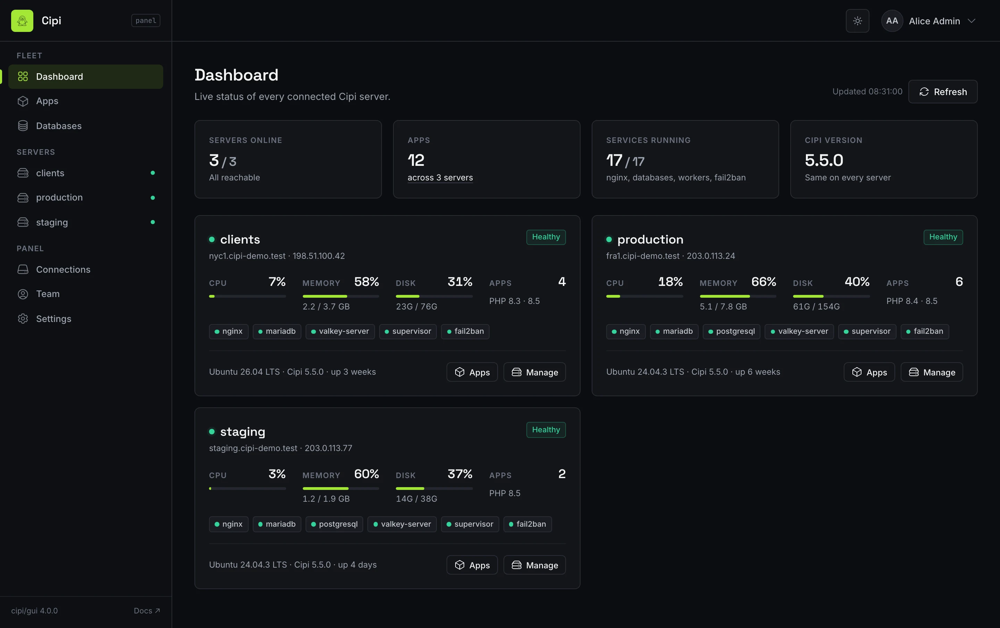
</picture>

Cipi stays CLI-first. The panel is a thin Laravel + Livewire client of the API: everything it does can still be done with `cipi` over SSH, it keeps no state about your servers besides an encrypted API token, and removing it leaves every server untouched.

> Screenshots in this README come from the bundled demo environment (`./dev/demo.sh`) — a stand-in for `cipi api` 1.36 with three fictional servers. See [Local development & demo](#local-development--demo).

## Requirements

- A Cipi server to host the panel — `cipi gui <domain>` provisions everything
- **Cipi API** on every server you manage (`cipi api`), ideally API **1.36+** (environment labels — production, staging, … — and `cipi-<env>.yml`); 1.35 / 5.6.4 for cipi.yml plan, apply and auto-apply; 1.34 / 5.6.0 for the build command at creation and the repository access check; 1.33 / 5.5.2 for disk usage; 1.31 / 5.4.1 for everything else
- PHP 8.3+, Laravel 12 or 13, Livewire 3.6+ or 4 (only relevant for manual installs)

## Installation

On a Cipi server:

```bash
cipi gui panel.example.com     # Laravel host app, FPM pool, vhost, scheduler, first admin
cipi gui ssl                   # Let's Encrypt for the panel
```

Updates: `cipi gui update` (Composer update + migrations + theme refresh) or `cipi gui upgrade` (clean rebuild). See the [GUI docs](https://cipi.sh/docs/gui) for every subcommand.

Manual install in an existing Laravel app:

```bash
composer require cipi/gui
php artisan vendor:publish --tag=cipi-gui-config
php artisan migrate
php artisan cipi:seed-gui-user --email=admin@example.com --password='a-long-passphrase'
```

## Connecting servers

1. Enable the API on the server: `cipi api`
2. Create a token with every ability the panel uses (the **Connections** page shows the same command with a copy button):

```bash
cipi api token create --name=gui --abilities=apps-view,apps-create,apps-edit,apps-delete,apps-suspend,apps-basicauth,apps-env,apps-auth,apps-artisan,apps-run,apps-deploy-config,aliases-view,aliases-create,aliases-delete,www-manage,redirects-view,redirects-manage,proxies-view,proxies-manage,node-view,node-manage,search-view,search-manage,deploy-manage,ssl-manage,dbs-view,dbs-create,dbs-manage,php-view,php-manage,ssh-view,ssh-manage,services-view,services-manage,smtp-view,smtp-manage,health-view,health-manage,packages-view,packages-manage,monitor-view,metrics-view,metrics-manage,zt-view,zt-manage,sync-manage,disk-view,yml-view,yml-manage,ip-whitelist-view,ip-whitelist-manage,status-view,firewall-view,firewall-manage
```

Or `cipi api token create --name=gui --full-access` (Cipi 5.9.0+): it also passes the abilities later versions add.

3. In the panel open **Connections → Add server** and enter a name, the API URL (`https://vps.example.com`) and the token. The connection is tested right away; tokens are encrypted at rest with Laravel's `Crypt`.

Sections a server's API or token does not support are shown as "not available" one by one — an older server still works for everything else.

## What you can do

| | |
|---|---|
| 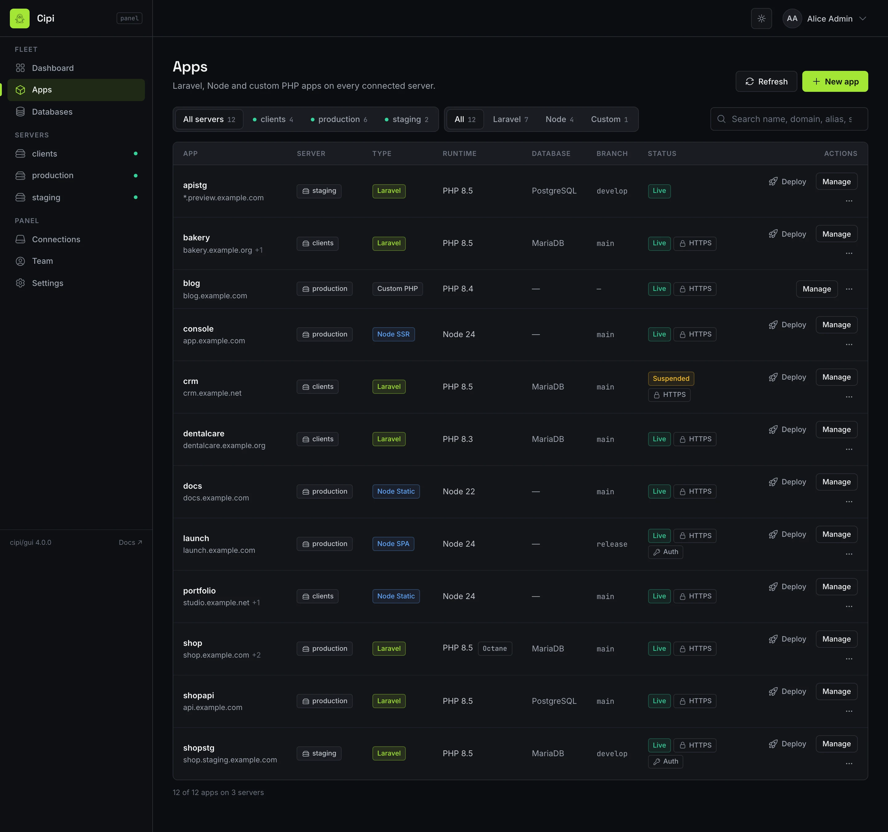 | **Apps** — Laravel (PHP-FPM or Octane/FrankenPHP), Node (SPA, static, SSR with Next, Nuxt, SvelteKit, Astro, Remix or Vite) and custom PHP apps of **every connected server in one list** (fleet view, on by default), with a server column and a server filter; `?server=` narrows it to one server. Every app carries its **environment** badge — production muted, staging and the rest highlighted. Filter by type, search by name, domain, alias, server or environment, deploy from the list. A **Last deploy** column says when each app was last deployed and how it went — whoever started it, a Git push included (Cipi 5.9.0+) — and the database column counts the databases linked to the app. With fleet view off, one server at a time, picked from the header. |
| 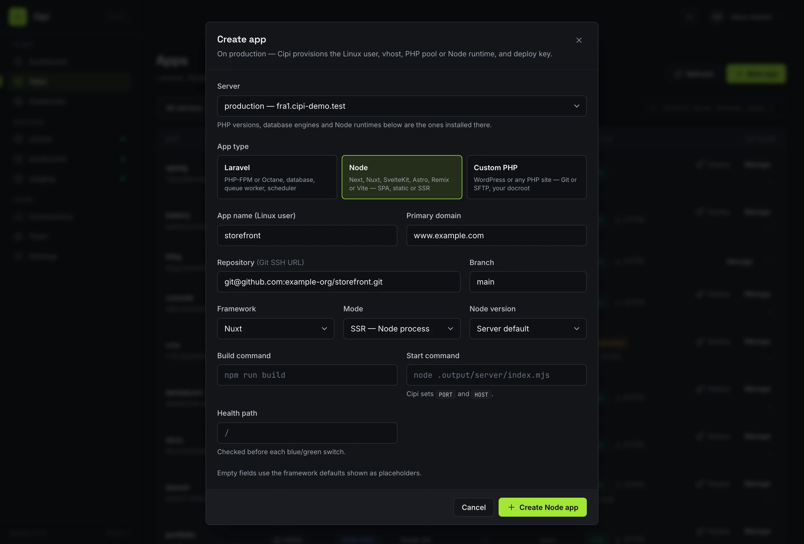 | **Create** apps with a type picker and, with several servers, a server picker; Node framework presets use the same defaults as `cipi app create --node`. Laravel apps take an optional **build command** (`npm ci && npm run build`) run on every deploy before the release goes live. An **environment** label (production by default; staging, development, testing or any lowercase word) tells the environments of a project apart and picks `cipi-<env>.yml` over `cipi.yml` on deploys. Wildcard primary domains (`*.example.com`) are accepted. The dialog keeps what you typed if it is closed. |
| 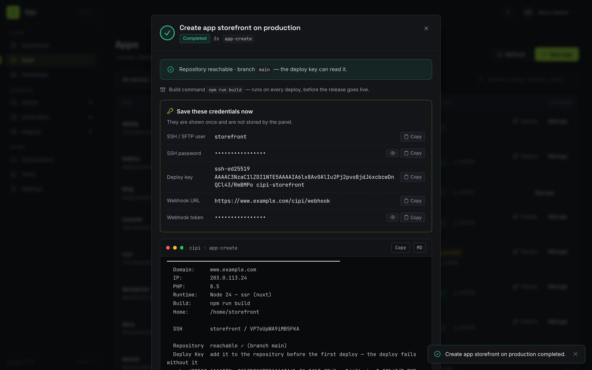 | **Async jobs** run in an overlay with live status, elapsed time and the CLI output. One-time secrets — SSH and database passwords, deploy key, webhook URL and token — are listed with copy buttons. After app create, and after a repository or branch change, the overlay says whether the deploy key can read the repository and, when it cannot, shows Git's error and the command to fix it on the server. |
| 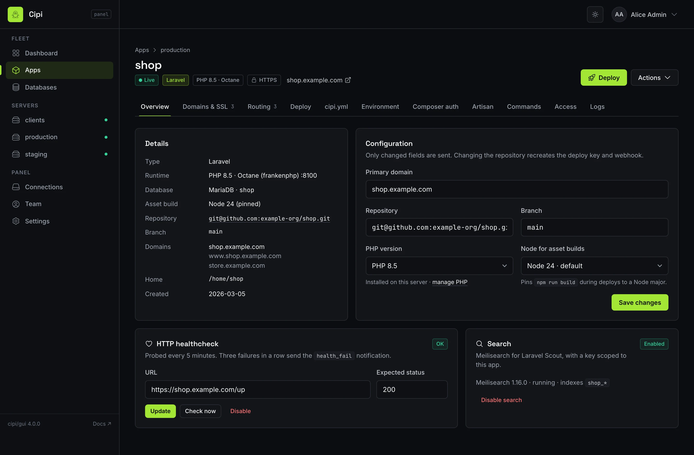 | **App overview** — details (with the app's user, the server's IP and the `ssh` command, each copied with a click), configuration (PHP version, Node pin, repository, branch, environment, domain), HTTP healthcheck and Meilisearch/Scout. Tabs are part of the URL, so every view can be bookmarked. |
| | **Environment** — the `.env` row by row with masked secrets and drag-and-drop order, or as text: paste a block of `KEY=value` lines and it is split into the list, or edit the whole list by hand. |
| 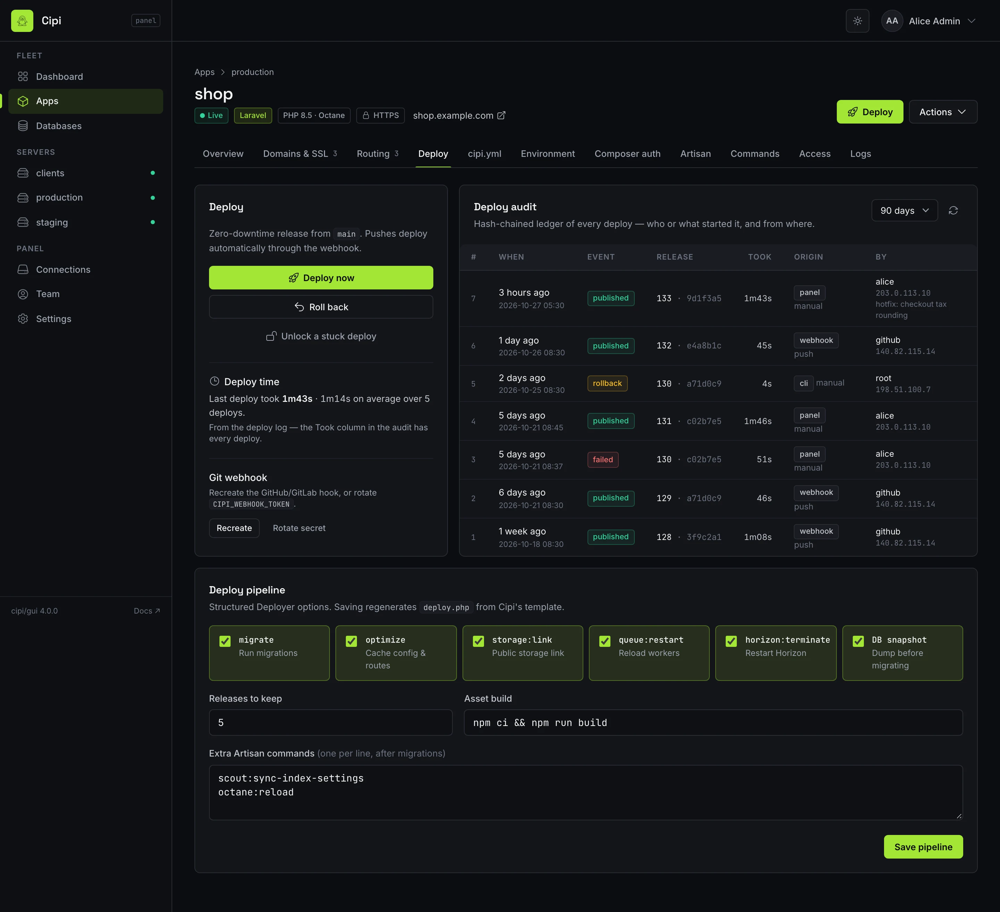 | **Deploy** — deploy, roll back, unlock, recreate or rotate the Git webhook, the hash-chained **deploy audit** (who, from where, which commit, **how long it took** — from the deploy log, Cipi 5.6+ — and **the log of each deploy**) and the structured `deploy.php` pipeline. **A deploy in progress is shown whoever started it** — a Git push, the command line, the panel — with its phase and the live tail of the log, and reported when it ends (cipi/api 1.37+, Cipi 5.8.4+). The **cipi.yml** tab shows the repository's `cipi.yml` against the server — the environment it was planned for and which file is read first (`cipi-staging.yml`, then `cipi.yml`), validity, the plan, blockers, in sync — applies it, and turns auto-apply after every deploy on or off. |
| 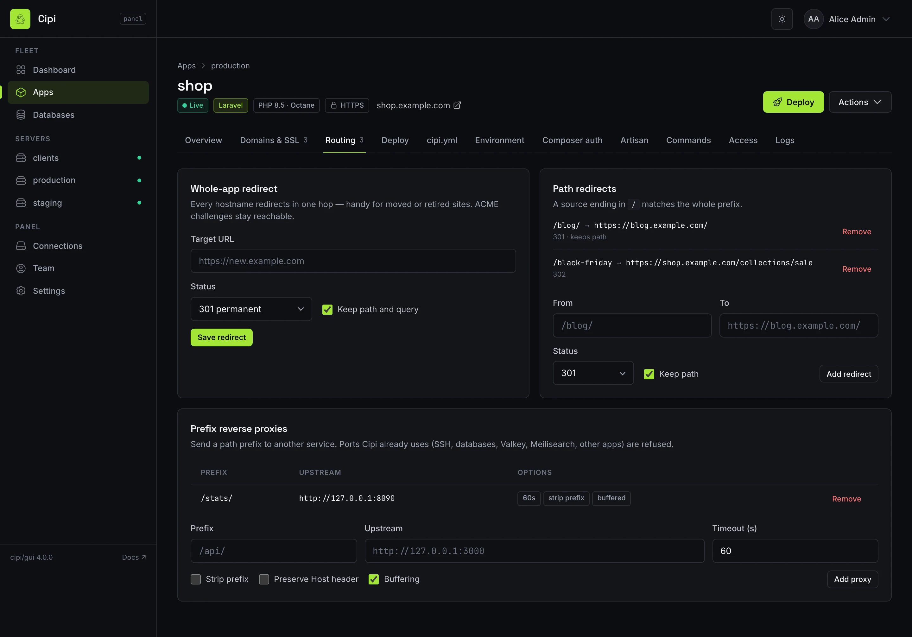 | **Routing** — whole-app redirect (set, toggle, remove), path redirects and prefix reverse proxies, with the same validation as `cipi redirect` / `cipi proxy`. Server managers also get **Nginx directives**: the app's own headers, caching, limits and `location` blocks, tested with `nginx -t` before the reload (Cipi 5.14.0+). |
| 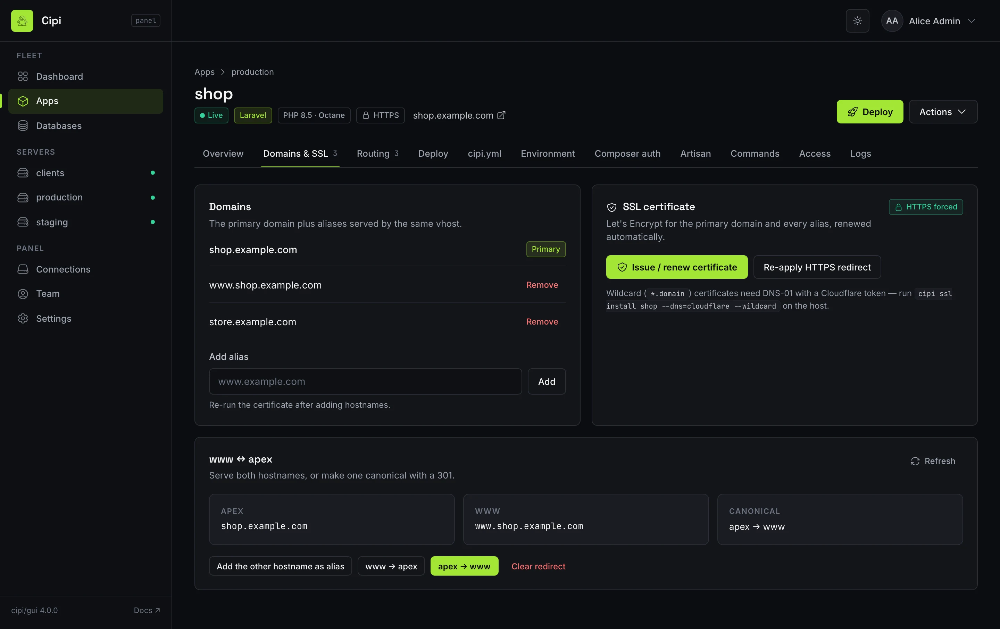 | **Domains & SSL** — aliases, Let's Encrypt, forced HTTPS and www ↔ apex canonical redirects. |
| 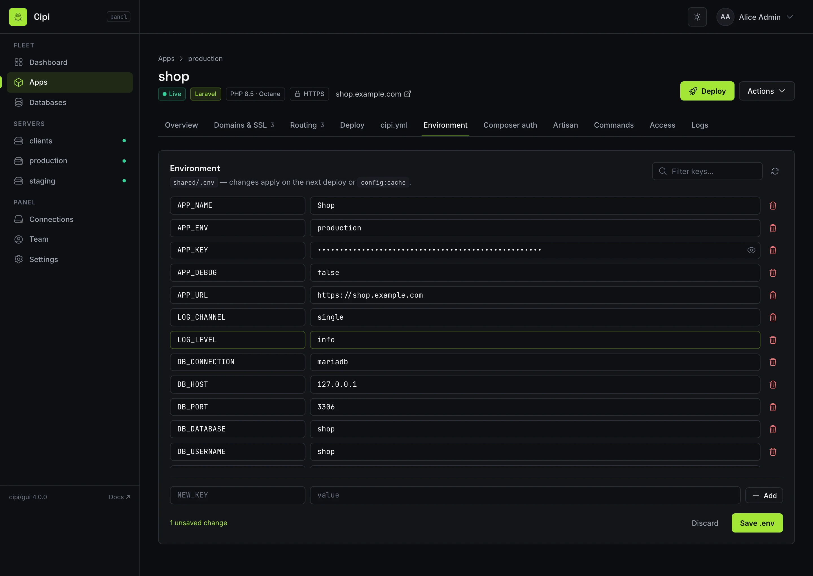 | **Environment** — edit `shared/.env` with sensitive values masked, a filter, changed rows highlighted before saving, and rows reordered by dragging them (Cipi 5.13.0+, cipi/api 1.43+). Also Composer `auth.json`, Artisan, whitelisted commands and HTTP basic auth. The one-click commands above the Artisan and Commands inputs are a list the panel's admins edit from the tab — add the ones the team runs, remove the ones it never does, the defaults included. |
| 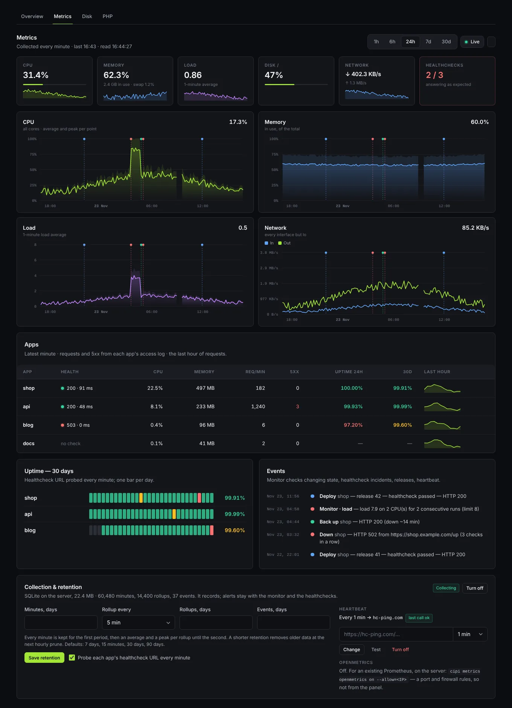 | **Metrics** (Cipi 5.11.0+, cipi/api 1.41+) — the server's history: CPU, memory, load and network over 1 hour to 30 days, with every deploy and incident marked on the charts and a tooltip on hover; per app the latest minute, the last hour of requests and uptime over 24 hours and 30 days; 30-day uptime bars like a status page; the timeline of monitor changes, incidents, releases and heartbeat. **Live**: read again every 30 seconds while the tab is on screen. Managers change the retention, the per-minute healthcheck probe and the **heartbeat** URL from the tab. |
| 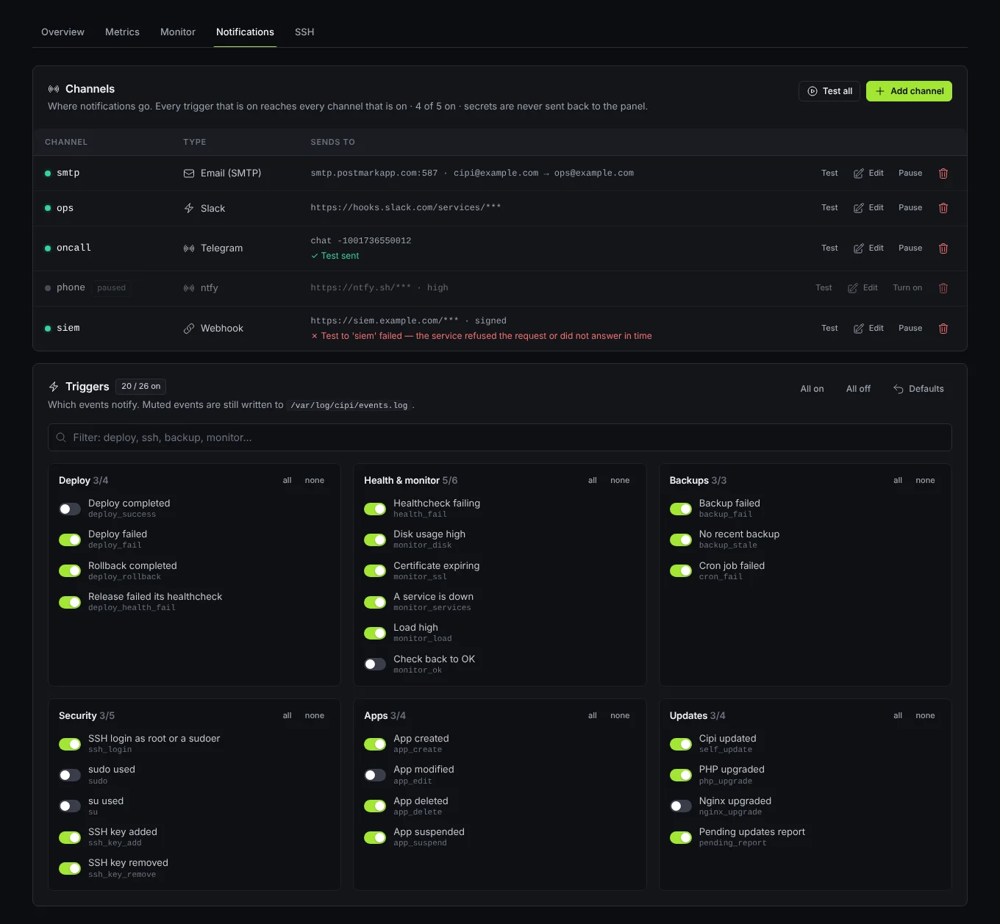 | **Notifications** (Cipi 5.12.0+, cipi/api 1.42+) — every channel of the server: email through SMTP, Resend or Amazon SES, Slack, Discord, Mattermost, Google Chat, Telegram, ntfy, Pushover and signed webhooks. Add one with a type picker that shows only its fields, edit it (secrets are never sent back: an empty secret keeps the stored one), pause it, test it — a refused test says why on its row — or remove it. **What each channel receives**: everything, or only some kinds of events — Urgent (failures and security), Security, Deploy, Backup, Monitor… — so one channel takes every notification, another only the alarms, another only the deploys. **Triggers** by category with switches, a filter, all/none per category, and one save for every change; muted events are still logged on the server. An older server keeps the SMTP form. |
| 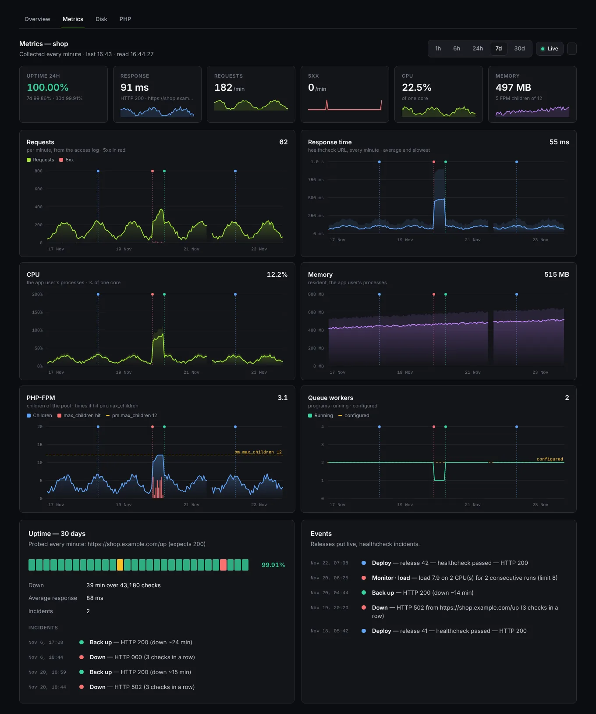 | **App metrics** — requests and 5xx per minute, healthcheck response time, CPU and memory of the app's processes, PHP-FPM children against `pm.max_children` and the minutes it was hit, queue workers; uptime per day, minutes down and the incidents. The **Access** tab says whether the cipi/agent routes stay outside basic auth, and switches it. |
| 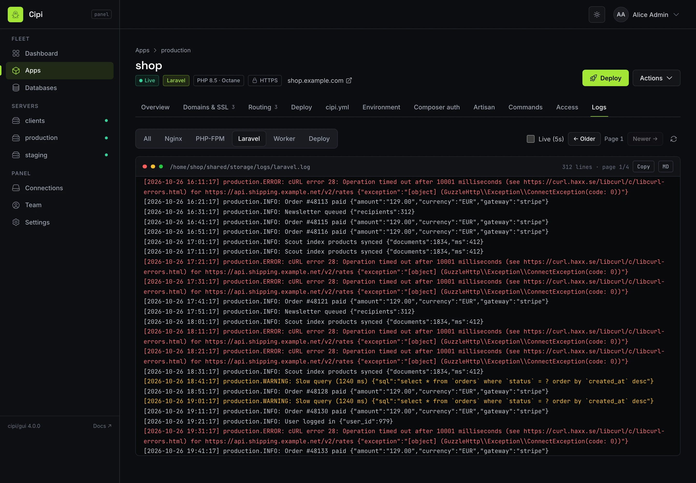 | **Logs** — nginx, PHP-FPM, Laravel, worker and deploy logs with pagination, live refresh and copy as Markdown. The tab is shown at once and reads the logs after. |
| 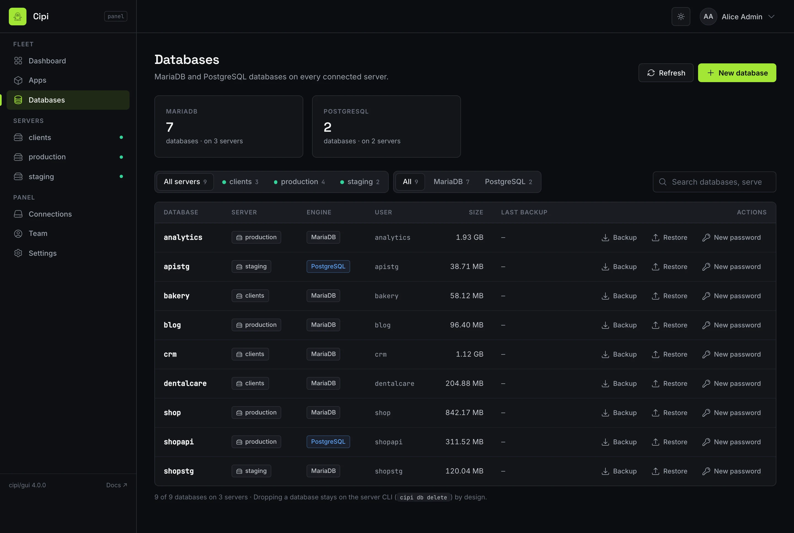 | **Databases** — MariaDB and PostgreSQL of every server in one list, like Apps: create (on the server you pick, optionally **for an app**), back up, restore and rotate passwords (dropping stays on the CLI by design). Each database shows **the app it belongs to** — the one it was created with, or the one it is linked to (`cipi db link`; link and unlink from the row). **Restore takes a dump from your computer** as well as a file on the server: `.sql` or `.sql.gz`, sent in chunks, up to the size the server allows (2 GB by default), with a progress bar and a Stop (Cipi 5.9.0+). |
| 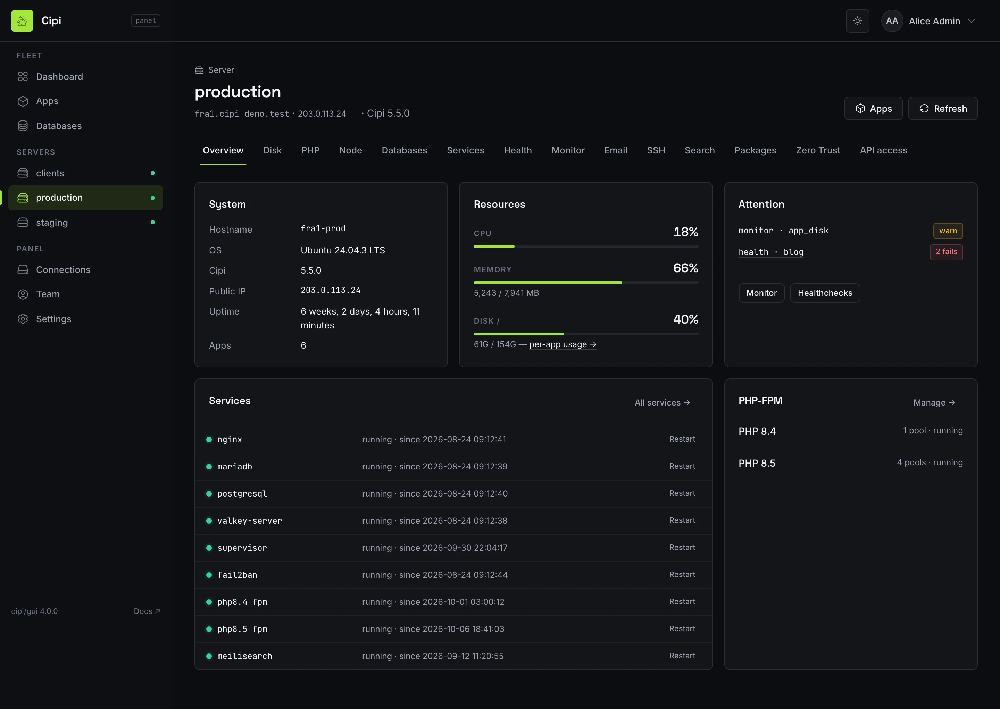 | **Server** — overview, **disk usage** (the filesystem, every app with files, database, total and soft limit, every database per engine), PHP versions, **Node runtimes** (install a major, upgrade to the latest patch with a no-downtime restart of the SSR apps, choose the server default, remove — Cipi 5.9.0+), **backups** (a matrix of every app and database against the backup profiles: what is taken, by which profile, where it goes, when it last ran, what nobody backs up; create, edit, pause, run and verify profiles — Cipi 5.9.0+; buckets are added on the server), database engines, services, healthchecks, monitor, email notifications, SSH keys, Meilisearch, **optional packages** (install, update and remove entries of the server's closed catalog — browsershot, ffmpeg, LibreOffice, Tesseract, CJK fonts, the security scanners Hackly runs… — Cipi 5.14.0+), Cloudflare Zero Trust and the API IP whitelist. |
| 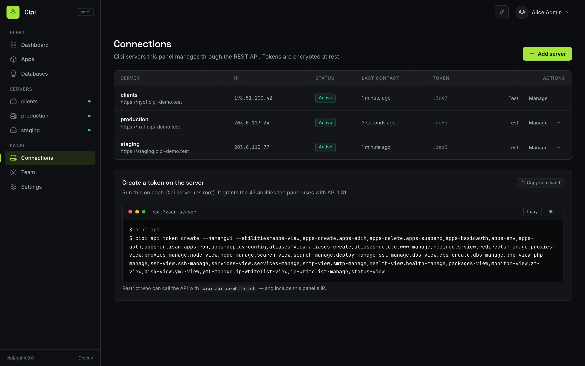 | **Connections** (admins) — add, edit, rotate tokens, disable or test servers. IPs copy on click, here and on the Dashboard and Server pages. |
| 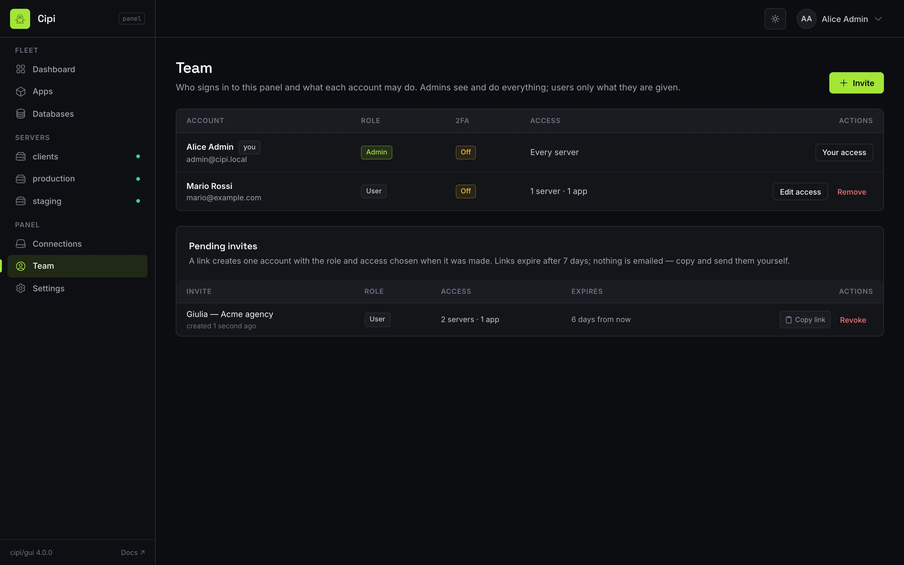 | **Team** (admins) — every account with its role and access. An **admin** sees and does everything; a **user** gets what an admin grants: **View** or **Manage** on whole servers, and **View, Deploy, Edit, Environment, Logs, Commands, Delete** on single apps. Invite people with a **copyable link** that carries the role and the grants — no email is sent; links work once and expire after 7 days. **Two-factor authentication can be required for every account** (off by default): whoever signs in with a password and has none is taken to its setup before anything else — at sign-in, or at the next page of a session already open — and cannot turn it off; sign-ins through SSO rely on the identity provider's MFA. An admin turns it on once their own 2FA is on, and resets another account's 2FA after a lost phone. `cipi compliance` reports the policy (control `gui_2fa`). |
| 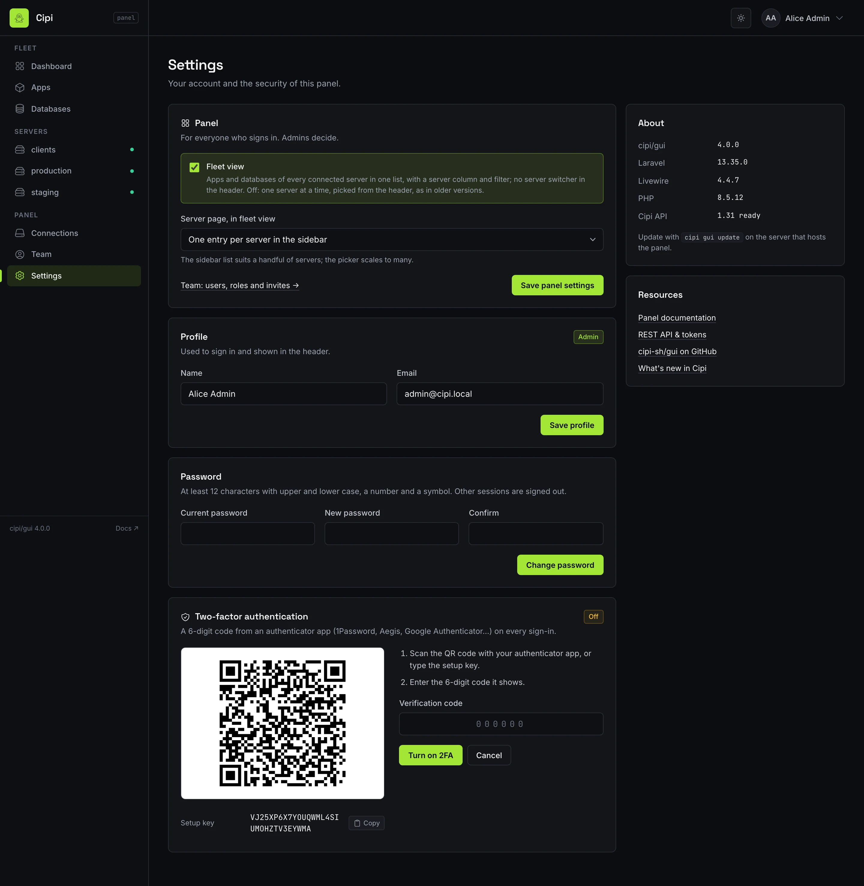 | **Settings** — profile, password (12+ characters, mixed case, number, symbol), TOTP two-factor authentication, passkeys and the account's **time zone** (UTC until chosen; every time the panel shows follows it). Admins also set the **panel** for everyone: fleet view on or off, and whether the Server page is reached from one sidebar entry per server or a picker on the page. |
| 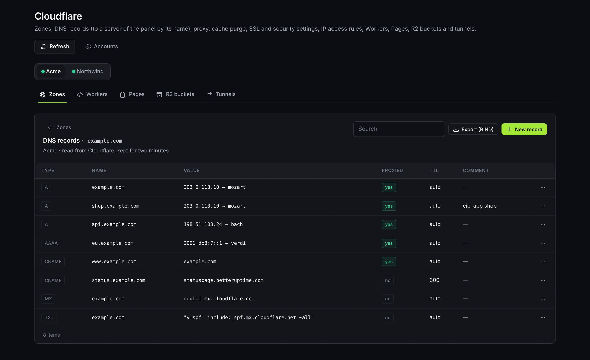 | **Infrastructure** (admins) — 28 providers around the servers, from the panel. **Clouds and VPS**: DigitalOcean, Hetzner, AWS (EC2, Lightsail, RDS, Route 53, CloudFront, the cost of the month), Google Cloud, Microsoft Azure, OVHcloud, Vultr, Akamai, Scaleway, Contabo, UpCloud. **Domains and DNS**: Cloudflare (zones, records, proxy, cache, SSL, IP access rules, Workers, Pages, tunnels), Porkbun, Gandi, Namecheap — each can **point a domain to its Cloudflare zone**. **Object storage**: Johnny, Backblaze B2, Wasabi, R2, Spaces, S3 — objects, links that expire, CORS, **keys for one bucket with the app's `.env`**. **Email**: Postmark, Mailgun, Resend, SES — **their DNS published on the Cloudflare zone** in one click. **Monitoring**: Boogle, Oh Dear, Better Stack, Sentry, Datadog, CloudWatch. **Security**: Aikido, Hackly. A DNS record's value can be **a server of the panel by its name** — `mozart` is saved as its IP, A or AAAA by its family — and every list says which server an address is. Any number of accounts per provider. |
| 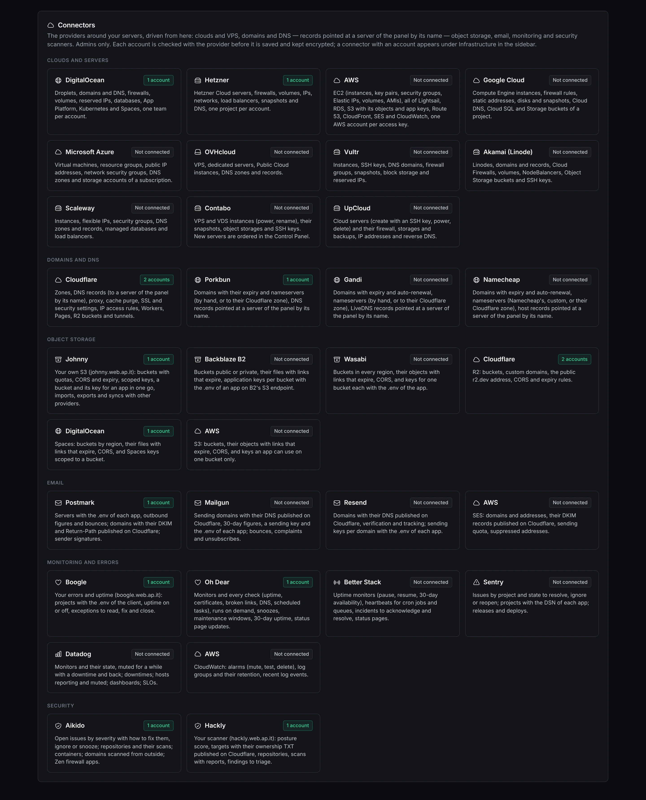 | **Settings → Connectors** (admins) — grouped by what they do; a provider's accounts, with **where to make the credentials and the permissions they need**, step by step. An account is checked with the provider before it is saved and kept encrypted; secrets are never sent back (an empty one keeps the stored value). A provider with an account appears in the sidebar under **Infrastructure**. |
| 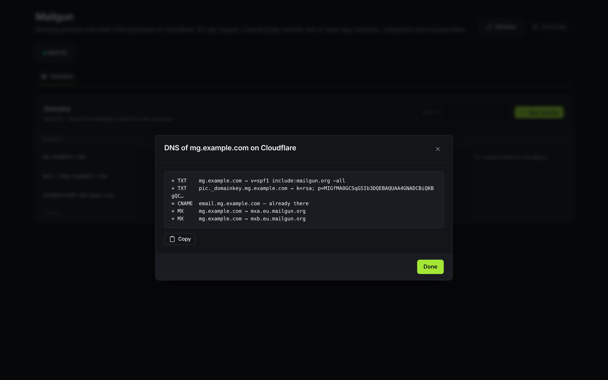 | **Publish DNS on Cloudflare** — a mail domain (Postmark, Mailgun, Resend, SES) or a Hackly target asks for DNS records: one click writes them into the domain's Cloudflare zone, on whichever account of the panel has it. Records already there are kept; a CNAME pointing elsewhere is reported, never overwritten. Registrars (Porkbun, Gandi, Namecheap) **point a domain to its Cloudflare zone** the same way. |
| 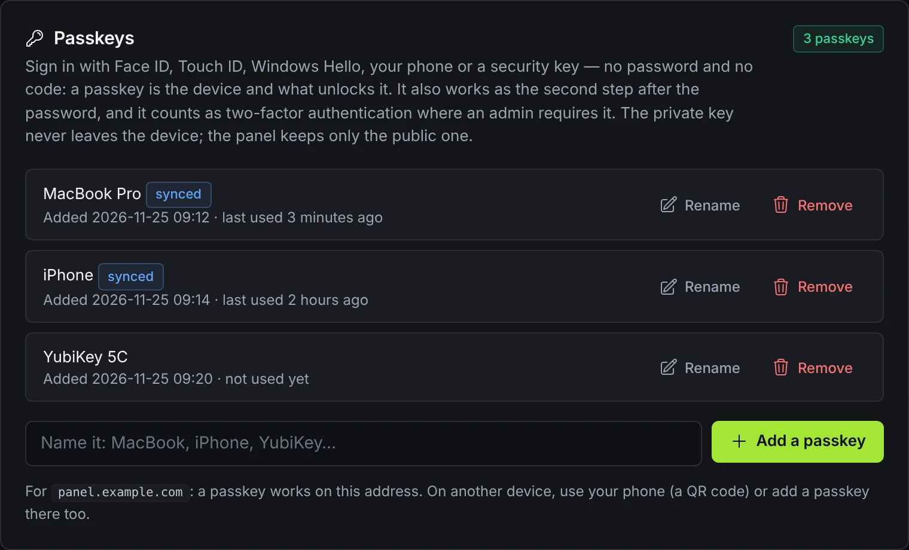 | **Passkeys** — sign in with Face ID, Touch ID, Windows Hello, a phone or a security key: **alone**, from the login page (also offered as the email field is filled), or as **the second step** after the password instead of the code. A passkey counts as two-factor authentication where an admin requires it, and can be added in the 2FA setup instead of an authenticator app. Added, renamed and removed in Settings; an admin's 2FA reset removes them too. No library: the panel checks WebAuthn itself (ES256, RS256, user verification required). |
| 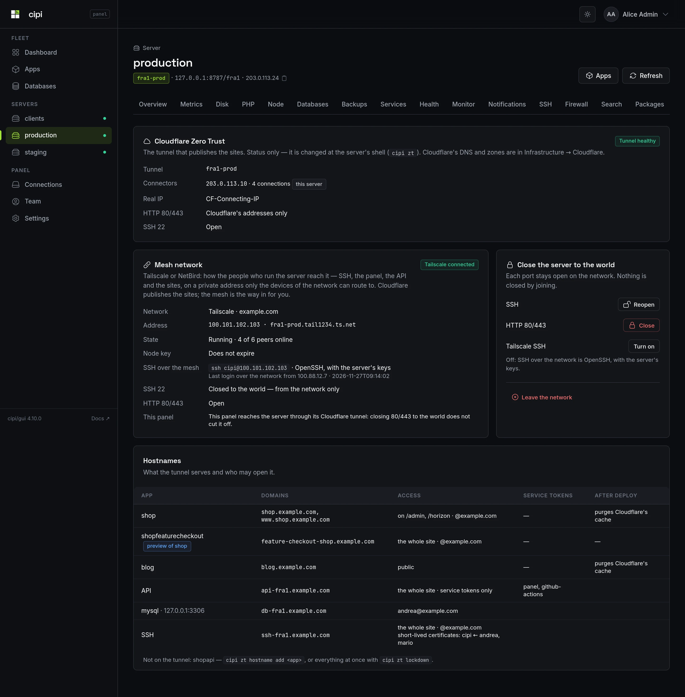 | **Zero Trust** (Cipi 5.16.0+, cipi/api 1.46+) — the server's tunnel as Cloudflare sees it (healthy, degraded, down; every connector and which one is this server), what is closed, and each hostname with **who may open it**: Access on some paths or the whole site, for which people or service tokens, TCP services (a database through the tunnel), SSH with short-lived certificates, previews of a branch and the apps purging Cloudflare's cache after a deploy. Under it, the **mesh network** (Cipi 5.18.0+, cipi/api 1.48+) — Tailscale or NetBird, the private side of Zero Trust — is **managed from the tab**: **join** a network with an auth key or a setup key (name, tags, a Headscale or self-hosted NetBird, direct connections, Tailscale SSH), see whether it is connected and why not, the server's address and name on it, peers online, the node key's expiry and the last SSH login that came over it; **close SSH and 80/443 to the world** and reopen them, each with its own button; turn **Tailscale SSH** on and off; **leave** the network. A button the server would refuse is greyed out with the server's reason next to it — nobody has signed in over the mesh yet, the node key can expire, the panel (or the page you are on) would lose the server. Cloudflare's side stays read-only: it is changed on the CLI (`cipi zt`). A server whose API is behind Cloudflare Access is reached with a **service token** (Connections → the server). |
| 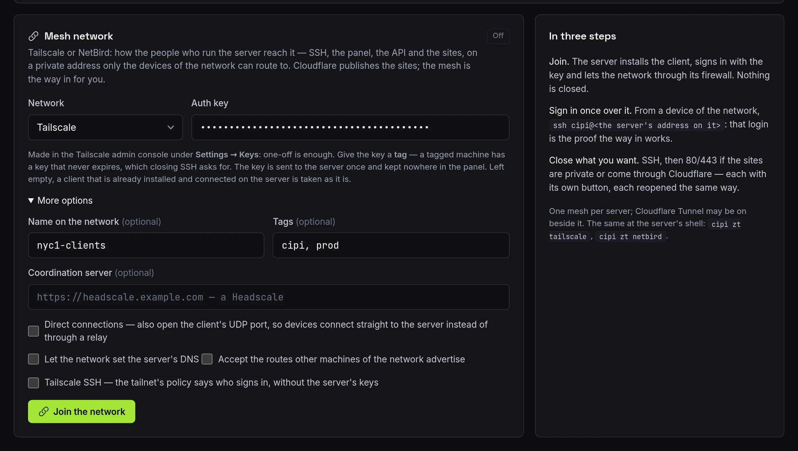 | **Zero Trust → Mesh network, on a server with none**: Tailscale or NetBird, the key, and under *More options* the machine's name, tags, the coordination server, direct connections, DNS, routes and Tailscale SSH. Beside it, the three steps: join, sign in once over the network, close what you want. |
| 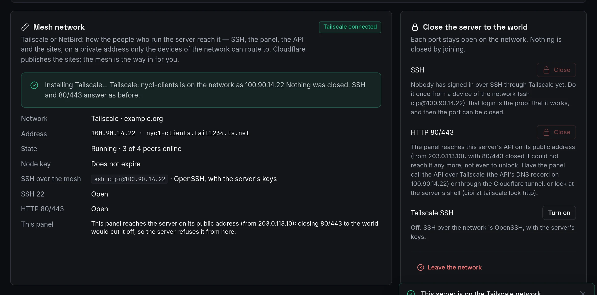 | **Right after joining**: the server's address on the network, and the two locks greyed out with the server's own reasons — nobody has signed in over SSH through the mesh yet, and this panel reaches the server on the public address a lock of 80/443 would close. The page decides nothing: it shows before the click what the server would answer after it. |
| 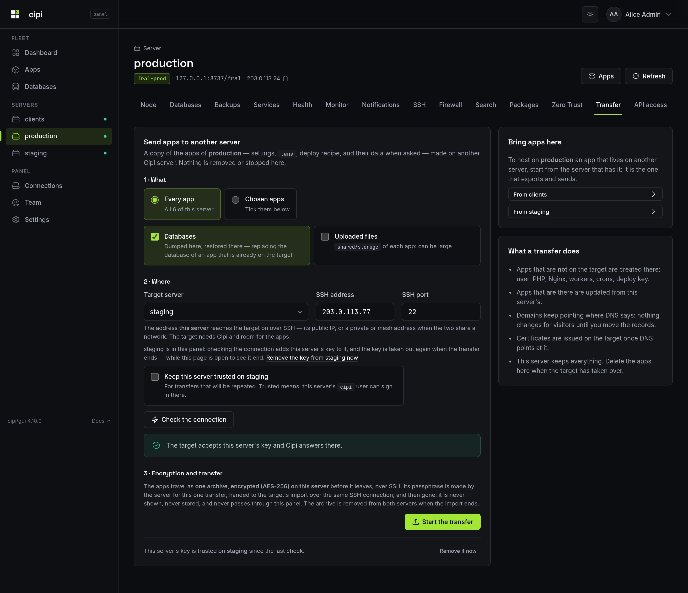 | **Transfer** — the apps of a server sent to another one (`cipi sync`) as a wizard: every app or the chosen ones (Laravel and custom apps; Node apps are not moved by a transfer yet), with databases and uploaded files or without; the target picked from the panel's servers or typed as an address; **the connection checked before anything moves**, with the answer in words. The source's key is added to a target of the panel for the transfer and taken out when it ends; for any other server the page shows the key to trust. **Encryption is managed**: the archive is encrypted on the source with a passphrase made for that one transfer and handed to the target over SSH — it never passes through the panel. The transfer runs as a job with live output; *Bring apps here* opens the other server's wizard with this one as the target. Needs the `sync-manage` ability. |
| 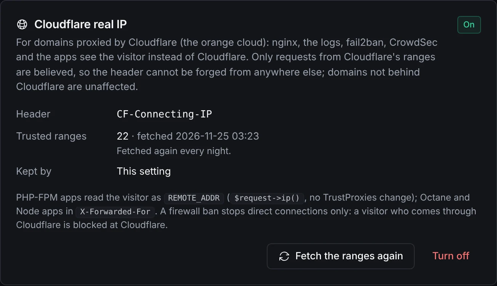 | **Firewall** (Cipi 5.14.0+, cipi/api 1.44+) — a server tab with UFW, fail2ban and CrowdSec together: the **rules** in UFW's order, each with its source and IPv4/IPv6, and which Cipi feature owns it; **open a port** or a range, to everyone or to one address, and remove what was opened; **block an address** on every port, ahead of every allow; the **banned addresses** of fail2ban and CrowdSec in one list with **Unban**; the **SSH login attempts** before a ban; **CrowdSec** on and off (with what would stop it — RAM, a reverse proxy without real_ip — said before trying) and its allowlist; **Cloudflare real IP** on, refreshed or off, so that nginx, the logs, fail2ban, CrowdSec and the apps see the visitor behind Cloudflare's proxy. What keeps the server reachable is never closed from here: its SSH port, 80 and 443, a Zero Trust lock, the panel's own address. |
| | **Page cache** (Cipi 5.17.0+, cipi/api 1.47+) — an app tab that turns nginx's page cache on and off, sets how long a page is kept and how much disk it may take, and **empties it** with one button. The tab says what it is — nginx keeps the page PHP made and answers the next visitors with it, without running PHP — and what it is not: **OPcache is on already** and keeps PHP's compiled code, so PHP still runs at every request. What you get (WordPress and content sites in about a millisecond, a small server through a traffic peak, pages still served while PHP is down), what is never cached (signed-in visitors, carts, admin, query strings, whatever the app marks private — and the **paths of its own** an app adds, one per line: `/cart*`, `/feed`), and **how to empty it**: nothing to do after a Cipi deploy, one command (`sudo /usr/local/bin/cipi-cache-clear <app>`) in a deploy recipe of your own, a cron or a WordPress hook — shown ready to copy. |
| | **Octane** (Cipi 5.17.0+, cipi/api 1.47+) — an app tab for an Octane app: the PHP that answers the requests (the one inside its FrankenPHP build) next to the PHP that runs Composer, artisan, cron and the workers, a warning when they are two versions with a button that puts them on one, **Switch PHP** by its number (the build is fetched when the server has none; Octane is checked and the previous build comes back when it does not answer), **Restart Octane** and **Update the build**. |
| | **Valkey per app** (Cipi 5.17.0+, cipi/api 1.47+) — Server → Services: every Laravel app with the Valkey it uses — its own instance or the server's shared one, whose password every app on it holds. **Isolate** one app or all of them (keys copied, workers restarted), share again, restart an instance, and **empty the shared instance** once nobody uses it. No password travels through the panel. |
| | **The server's own name** — next to the name a server has in the panel (`production`), its hostname (`vmi12334`): a column of its own in Connections, on the server page, the dashboard and the server switcher. It is what a notification calls the server — unless Notifications → **Written as** gives it the panel's name in one click, and sets the **time zone** of every notification's `Time:` line. |
| | **Single sign-on** (opt-in) — "Sign in with Microsoft Entra ID" (Google Workspace, Okta, Keycloak… anything that speaks OpenID Connect) next to the password form, or instead of it with `CIPI_GUI_SSO_ONLY`. Existing accounts are matched by email and linked; people from the allowed domains get a user account with no access on first sign-in; everyone else needs an invite link. The provider's MFA replaces the panel's 2FA step. Set up on the server: `cipi gui sso set --issuer=… --client-id=… --client-secret=…` (Cipi 5.8.2+). |

Light and dark themes follow the system preference (toggle in the header), and the layout adapts to phones:

<p>
  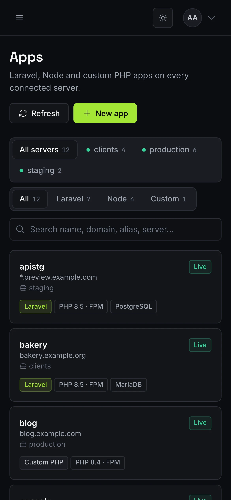
  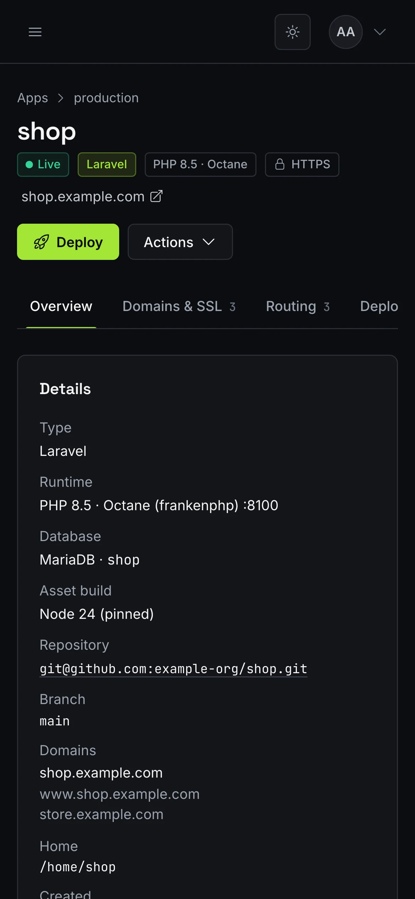
  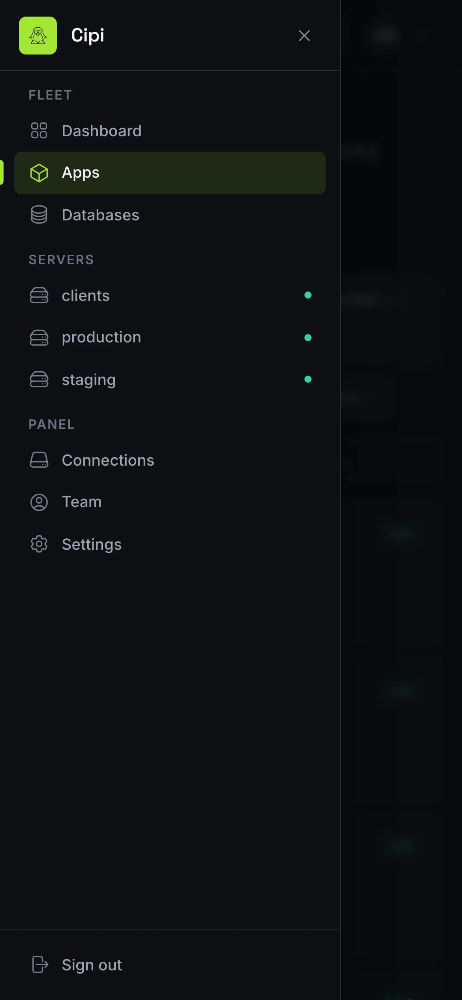
</p>

## API coverage

The panel targets **Cipi API 1.36** and degrades per section on older APIs or narrower tokens.

| Area | Endpoints |
|------|-----------|
| Status | `GET /api/status` — dashboard (queried concurrently for every server) and server overview |
| Apps | `GET/POST /api/apps`, `GET/PUT/DELETE /api/apps/{name}`, suspend, unsuspend, fix-permissions, webhook recreate; create accepts `engine`, `octane`, `custom`/`docroot`, `node_build` for Laravel (API 1.34+) and Node (`node`, `framework`, `node_version`, `build`, `start`, `output`, `health_path`); create and update take `env` and app objects carry it (API 1.36+ — older servers drop it and list every app as production) |
| Env / auth.json | `GET/PUT /api/apps/{name}/env`, `GET/POST/PUT/DELETE /api/apps/{name}/auth` |
| Artisan / commands | `POST /api/apps/{name}/artisan`, `GET /api/run-commands`, `POST /api/apps/{name}/run` |
| Deploy | deploy, rollback, unlock, `GET /api/apps/{name}/deploy/audit`, `GET /api/apps/{name}/deploy/status` (1.37+), `GET /api/apps/{name}/deploy/history` and `GET /api/deploys/last` (1.39+, Cipi 5.9.0+: durations from the rotated deploy logs too, and the app list's last deploy), `GET/PUT /api/apps/{name}/deploy-config` |
| cipi.yml | `GET /api/apps/{name}/yml` (with `env` next to `file` since API 1.36: `cipi-<env>.yml` is read first, then `cipi.yml`), `POST /api/apps/{name}/yml/apply` (job `app-yml-apply`), `POST /api/apps/{name}/yml/auto/enable` and `…/disable` — abilities `yml-view` / `yml-manage` (API 1.35+, Cipi 5.6.4+) |
| Domains | aliases, `www` status/add/force-to-root/force-from-root/clear, `ssl`, `ssl/force` |
| Routing | `/redirects`, `/redirect` (set, enable, disable, unset), `/proxies` |
| Node | `GET /api/node`, `GET /api/apps/{name}/node`, `POST /api/apps/{name}/node/restart`; runtimes: `POST /api/node/install`, `POST /api/node/upgrade`, `PUT /api/node/default`, `DELETE /api/node/{major}` (1.39+, ability `node-runtimes-manage`) |
| Search | `GET /api/search`, `POST /api/apps/{name}/search/enable` and `…/disable` |
| Health | `GET /api/health`, `GET/PUT/DELETE /api/apps/{name}/health`, `POST /api/apps/{name}/health/check` |
| Databases | `GET /api/dbs/engines`, `POST /api/dbs/engines/install`, `GET/POST /api/dbs`, backup, restore, password; 1.39+: `app` on create, `POST/DELETE /api/dbs/{name}/link`, dump upload (`GET /api/dbs/uploads/limits`, `POST /api/dbs/uploads`, `POST /api/dbs/uploads/{id}/chunks`, `DELETE /api/dbs/uploads/{id}`, then restore with `upload_id`) |
| Backups | `GET /api/backups`, `GET /api/backups/runs`, `POST /api/backups/run`, `POST /api/backups/verify`, `POST /api/backups/destinations/test`, `POST /api/backups/profiles`, `PUT/DELETE /api/backups/profiles/{name}`, `…/enable`, `…/disable` — abilities `backups-view` / `backups-manage` (1.39+, Cipi 5.9.0+) |
| Server | PHP list/install, SSH keys, services + restart, SMTP (configure, enable, disable, test, delete), packages (list; install and remove — `packages-manage`, API 1.44+ / Cipi 5.14.0+), monitor, Zero Trust, IP whitelist |
| Zero Trust | `GET /api/zt` — ability `zt-view`; `details` from 1.46 (Cipi 5.16.0+), `details.mesh` from 1.48 (Cipi 5.18.0+). The mesh network: `POST/DELETE /api/zt/mesh` (join, leave), `POST/DELETE /api/zt/mesh/lock` (close and reopen SSH or 80/443), `PUT /api/zt/mesh/ssh` (Tailscale SSH) — ability `zt-manage`, API 1.48+ / Cipi 5.18.0+ |
| Page cache | `GET/PUT /api/apps/{name}/cache`, `PUT /api/apps/{name}/cache/exclude`, `POST /api/apps/{name}/cache/clear` — abilities `nginx-view`, `nginx-manage` (API 1.47+, Cipi 5.17.0+) |
| Octane | `GET /api/apps/{name}/octane`, `PUT /api/apps/{name}/octane/php` (job `octane-php`), `POST /api/apps/{name}/octane/restart` (job `octane-restart`), `POST /api/frankenphp/upgrade` — abilities `php-view`, `php-manage` (API 1.47+, Cipi 5.17.0+) |
| Valkey per app | `GET /api/valkey`, `POST /api/valkey/isolate` and `/share` (jobs), `POST /api/valkey/{app}/restart`, `POST /api/valkey/flush-shared` — abilities `services-view`, `services-manage` (API 1.47+, Cipi 5.17.0+) |
| Notification settings | `settings` in `GET /api/notifications`, `PUT /api/notifications/settings` — the time zone and the server name (API 1.47+, Cipi 5.17.0+) |
| Transfer | `GET /api/sync/key`, `POST /api/sync/check`, `POST/DELETE /api/sync/trust`, `POST /api/sync/push` (job `sync-push`) — ability `sync-manage`; cipi/api 1.48 on Cipi 5.18.0+, on the source and on a target the panel prepares. No passphrase is sent or received: the source makes it for the transfer. |
| Firewall | `GET /api/firewall`, `POST/DELETE /api/firewall/rules`, `POST/DELETE /api/firewall/blocks`, `PUT /api/firewall/attempts`, `DELETE /api/firewall/bans`, `POST/DELETE /api/firewall/crowdsec/allowlist`, `POST /api/firewall/crowdsec/enable` and `…/disable` (jobs `crowdsec-enable`, `crowdsec-disable`), `PUT/DELETE /api/firewall/real-ip`, `POST /api/firewall/real-ip/refresh` — abilities `firewall-view` / `firewall-manage` (1.44+, Cipi 5.14.0+) |
| Metrics | `GET /api/metrics`, `GET /api/metrics/series`, `GET /api/apps/{name}/metrics`, `GET /api/metrics/uptime`, `GET /api/metrics/events`, `GET/PUT /api/metrics/settings`, `PUT/DELETE /api/metrics/heartbeat`, `POST /api/metrics/heartbeat/test`; `GET/PUT /api/apps/{name}/basicauth/agent` — abilities `metrics-view` / `metrics-manage` (1.41+, Cipi 5.11.0+) |
| Disk | `GET /api/disk`, `GET /api/disk/dbs` — the figures of `cipi disk` / `cipi disk db` (API 1.33+, Cipi 5.5.2+ for the API sudoers); measured on request, so these two calls use `http_disk_timeout` |
| Logs | `GET /api/apps/{name}/logs` |
| Jobs | `GET /api/jobs/{id}`; reads `repository_access` and `build` from app create / app edit results (API 1.34+, Cipi 5.6.0+) and the outcome of a cipi.yml apply (API 1.35+, Cipi 5.6.4+) |

`cipi disk` is in the panel since API 1.33 (**Server → Disk**). What is not in the panel yet — per-app disk limits and Cloudflare DNS accounts (API 1.32), `cipi ssh apps` — is pointed to with the command where it matters. On purpose never in the panel: Cloudflare's side of Zero Trust (`cipi zt enable`, hostnames, Access, its locks), opening the SSH port, 80 or 443 from the Firewall tab while a lock holds them (the mesh network's locks are in the Zero Trust tab), CrowdSec's rescue listener.

## Configuration

`config/cipi-gui.php` (publish with `--tag=cipi-gui-config`):

| Key | Description | Default |
|-----|-------------|---------|
| `route_prefix` | URL prefix for every panel route | `''` |
| `job_poll_interval_ms` | How often a running job is polled | `1500` |
| `job_poll_max_attempts` | Poll attempts before giving up | `120` |
| `http_timeout` / `http_connect_timeout` | API request timeouts (seconds) | `30` / `10` |
| `http_disk_timeout` | Timeout for `GET /api/disk*`, which measure every app home on request (seconds) | `180` |
| `php_versions` | Fallback PHP hints when a server cannot list its versions | `['8.4', '8.5']` |
| `token_abilities` | Abilities shown in the token command on Connections | API 1.44 list |
| `sso` | Single sign-on over OpenID Connect: issuer, client id and secret, button label, auto-provisioned domains, SSO-only, scopes — written to `.env` by `cipi gui sso` | off |

Environment variables: `CIPI_GUI_PREFIX`, `CIPI_GUI_JOB_POLL_MS`, `CIPI_GUI_JOB_POLL_MAX`, `CIPI_GUI_HTTP_TIMEOUT`, `CIPI_GUI_HTTP_CONNECT_TIMEOUT`, `CIPI_GUI_HTTP_DISK_TIMEOUT`, `CIPI_GUI_DB_UPLOAD_CHUNK_MB` (4: how much of a dump one request carries, never more than this PHP accepts), `CIPI_GUI_ADMIN_EMAIL`, `CIPI_GUI_ADMIN_NAME`; for single sign-on `CIPI_GUI_SSO_ISSUER`, `CIPI_GUI_SSO_CLIENT_ID`, `CIPI_GUI_SSO_CLIENT_SECRET`, `CIPI_GUI_SSO_LABEL`, `CIPI_GUI_SSO_DOMAINS`, `CIPI_GUI_SSO_ONLY`, `CIPI_GUI_SSO_SCOPES` (redirect URI to register at the provider: `{APP_URL}/auth/sso/callback`).

Artisan commands: `cipi:seed-gui-user` (create or `--reset` the admin), `cipi:gui-refresh-theme`, `cipi:gui-version`.

## Local development & demo

```bash
./dev/setup.sh      # Laravel host app in dev/host that loads this package from the working tree
./dev/demo.sh       # demo API + panel on http://127.0.0.1:8000 (admin@cipi.local / admin)
```

`dev/demo/api` is a stateful stand-in for `cipi api` 1.36: three fictional servers (production, client hosting, staging) with Laravel, Node and custom apps, databases, monitor checks, a deploy ledger and logs. Async jobs go from pending to completed with CLI-like output, and changes persist until `./dev/demo.sh --reset`. Domains and IPs are reserved documentation ranges. Details in [`dev/README.md`](dev/README.md).

Tests (Orchestra Testbench + PHPUnit) and the CI matrix (PHP 8.3–8.6 × Laravel 12/13 × Livewire 3/4; PHP 8.6 with Laravel 13 only, as Laravel 12 does not support PHP 8.6 upstream):

```bash
composer install
composer test
```

## Architecture

```
cipi/gui
├── config/cipi-gui.php
├── database/migrations/        # cipi_servers, cipi_settings, grants, invites; users columns (2FA, role, sso_subject)
├── resources/
│   ├── css/cipi-gui.css         # theme, inlined — no build step
│   └── views/                   # layouts, partials, <x-cipi::…> components, Livewire views
├── routes/web.php
├── src/
│   ├── CipiGuiServiceProvider.php
│   ├── Livewire/                # Dashboard, Servers, Apps, AppDetail, Databases, ServerManage, Settings, LogViewer
│   ├── Services/                # CipiApiClient, JobOutputParser, TwoFactorService, OidcClient (single sign-on)
│   ├── Support/                 # Theme, Icons, BuildCommand (the CLI's build-command rule), AppEnv (environment labels)
│   └── Models/CipiServer.php
├── dev/                         # host bootstrap + demo API
└── tests/
```

How `cipi gui` provisions the panel on a server is described in [`docs/CIPI_CLI.md`](docs/CIPI_CLI.md). Release notes: [`CHANGELOG.md`](CHANGELOG.md).

## License

MIT
